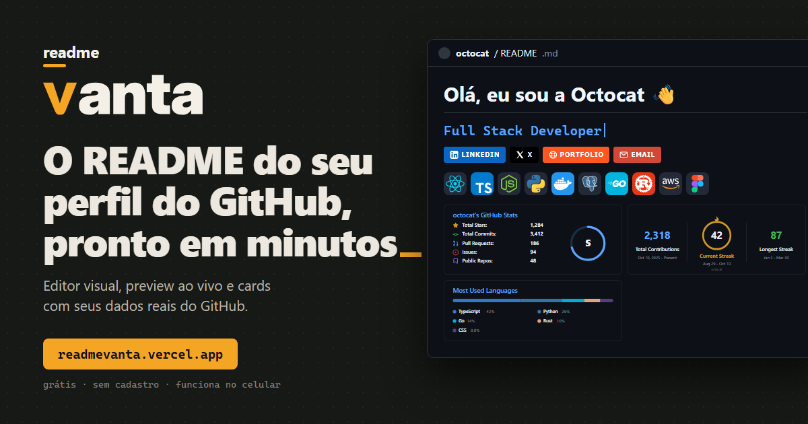
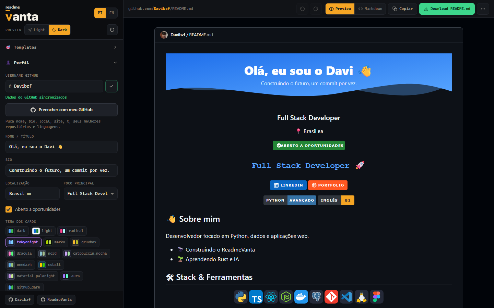
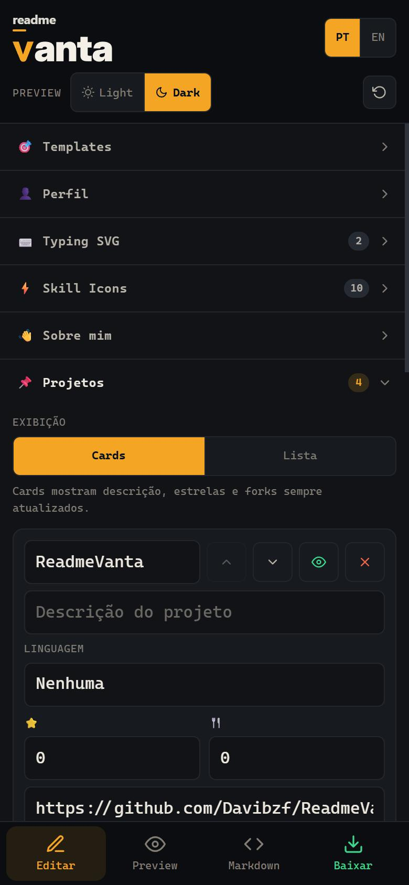
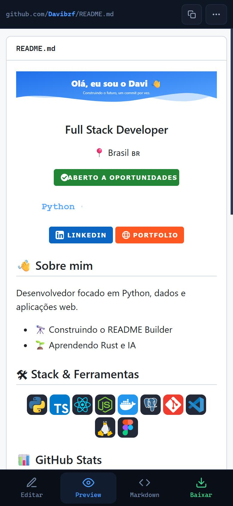
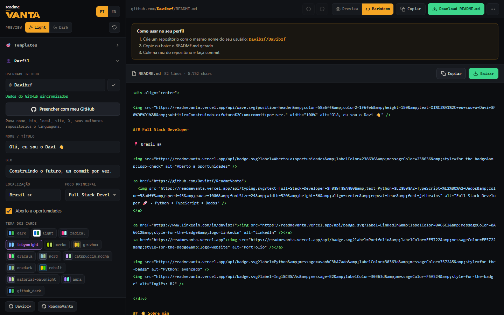

 
 

---

## O que é

O **ReadmeVanta** monta o README do seu perfil do GitHub **sem você escrever uma linha de Markdown**. Digite seu usuário, clique em *Preencher com meu GitHub*, ajuste o que quiser vendo o resultado em tempo real e baixe o `README.md` pronto.

Sem cadastro, sem instalar nada — no computador, no tablet ou no celular.

  

---

## Recursos

| | |
|---|---|
| ⚡ **Preencher com meu GitHub** | Nome, bio, local, site, X, seus melhores repositórios e linguagens em um clique |
| 📊 **Cards com dados reais** | Stats, sequência, linguagens, troféus, gráfico de atividade e calendário de contribuições — **atualizam sozinhos** |
| 📌 **Cards de repositório** | Seus projetos com descrição, estrelas e forks sempre atualizados |
| ⌨️ **Typing SVG** | Frases que digitam e apagam, com cor, fonte, velocidade e tamanho ajustáveis |
| 🧩 **430+ ícones** | 250+ tecnologias: linguagens, frameworks, bancos, cloud, DevOps, IA (OpenAI, Ollama, Gemini…), design e games |
| 🏷️ **Badges** | Redes sociais com ícone + badges personalizados (ex.: *Python · avançado*, *Inglês · B2*) |
| 🎨 **14 temas** | dark, light, tokyonight, dracula, radical, nord, catppuccin, gruvbox, onedark e mais |
| 🌊 **Banner em onda** | Cabeçalho e rodapé com seu nome, na sua cor |
| 🐍 **Snake** | A cobrinha que come seus commits — o app gera o workflow pra você |
| 🧱 **Plugins** | WakaTime, Spotify, LeetCode, Codewars, HackerRank e contador de visitas |
| ↕️ **Ordem livre** | Reordene ou esconda qualquer seção, ícone ou projeto |
| ↩️ **Desfazer / refazer** | `Ctrl+Z` / `Ctrl+Y` em qualquer alteração |
| 🔗 **Link de compartilhamento** | Envie sua configuração por um link — quem abrir vê exatamente o mesmo |
| 👁 **Preview fiel** | O preview usa o mesmo gerador das imagens do README: o que você vê é o que aparece no GitHub |
| 🌐 **PT / EN** | Interface e README em português ou inglês |

---

## Feito para qualquer tela

  
  &nbsp;
  

No celular, a barra inferior alterna entre <b>Editar</b>, <b>Preview</b>, <b>Markdown</b> e <b>Baixar</b>.

---

## Exemplo ao vivo

Estes cards são gerados pelo ReadmeVanta agora, com dados reais do GitHub:

---

## Como usar

1. Acesse **[readmevanta.vercel.app](https://readmevanta.vercel.app)**
2. Digite seu **usuário do GitHub** e clique em **Preencher com meu GitHub**
3. Personalize: textos, ícones, cards, badges, ordem das seções
4. Clique em **Download README.md** (ou copie o Markdown)
5. No GitHub, crie um repositório **com o mesmo nome do seu usuário** (ex.: `seu-usuario/seu-usuario`) e coloque o arquivo na raiz

Pronto — o README aparece no topo do seu perfil.

  

---

## Perguntas frequentes

<b>Preciso pagar ou criar conta?</b>

 
Não. É gratuito e não pede cadastro nem login.

<b>Os números dos cards ficam desatualizados?</b>

 
Não. Stats, sequência, linguagens, troféus, gráficos e cards de repositório são gerados quando alguém abre seu perfil, com seus dados públicos atuais.

<b>Meus dados ficam salvos em algum servidor?</b>

 
A configuração fica só no seu navegador. O link de compartilhamento leva a configuração dentro da própria URL. Os cards consultam apenas dados <b>públicos</b> do GitHub.

<b>Como coloco a cobrinha (snake)?</b>

 
Ative o plugin <b>Snake</b>, clique em <b>Baixar snake.yml</b> e salve o arquivo em <code>.github/workflows/snake.yml</code> no repositório do seu perfil. Depois rode a Action uma vez em <i>Actions → Generate snake animation → Run workflow</i>.

<b>Funciona no celular?</b>

 
Sim. A interface se adapta a celulares, tablets e computadores, e dá para baixar o <code>README.md</code> direto do celular.

---

🇺🇸 <b>English</b>

 

**ReadmeVanta** builds your GitHub profile README visually — no Markdown, no sign-up, any device.

- One-click **Fill from my GitHub** (profile, socials, best repositories, languages)
- Live cards: stats, streak, top languages, trophies, activity graph, contribution calendar, repository cards
- Animated typing SVG, 430+ icons for 250+ technologies, social and custom badges, wave banners
- 14 themes, templates, free section ordering, undo/redo, shareable config links, PT/EN

👉 **[readmevanta.vercel.app](https://readmevanta.vercel.app)**

---

<picture>
  <source media="(prefers-color-scheme: dark)" srcset="assets/wordmark-dark.svg" />
  
</picture>

Feito por **[Davibzf](https://github.com/Davibzf)** · Gostou? Deixe uma ⭐

